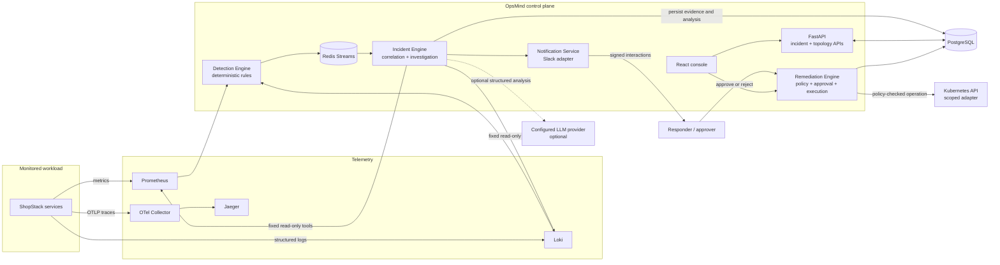
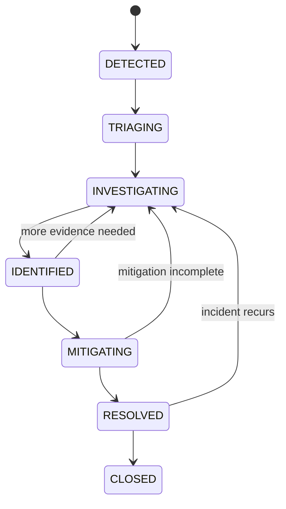
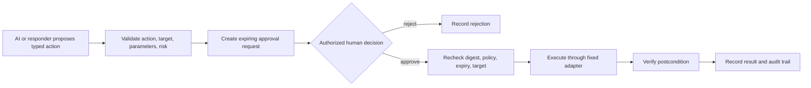

# OpsMind

OpsMind is an incident-response control plane for distributed applications. It detects service anomalies, groups related signals into incidents, collects timestamped evidence, and helps responders investigate and safely resolve failures.

It exists because production response is usually split across alerting, logs, deployment history, service ownership, chat, and infrastructure tools. OpsMind brings those records into one incident timeline and makes the path from diagnosis to an approved action explicit and auditable.

> **Project status:** OpsMind is an actively developed open-source project and portfolio system. Local end-to-end flows are runnable; production use still requires an identity provider, environment-specific integrations, secret management, and deployment validation. Production API authentication fails closed; local Compose can opt into a single-tenant demo token.

## What it does

- Polls Prometheus and Loki and applies deterministic thresholds, rolling baselines, z-scores, error-rate, latency, traffic-drop, and repeated-log detectors.
- Correlates anomalies by service, dependency attribution, signature, and time window, then creates or updates an incident without duplicating repeated signals.
- Collects source-backed evidence from incident records, Prometheus, Loki, deployments, service dependencies, restarts, configuration changes, and infrastructure signals. Evidence records retain provenance and timestamps.
- Runs an optional bounded LLM investigation using a fixed read-only tool allowlist and a structured, evidence-cited response.
- Recommends allowlisted remediation actions. Policy checks and a human approval are required before execution; execution and outcomes are audited.
- Exposes incident APIs and a React console, plus response-process metrics, dashboards, and alerts.

The current investigator has tools for timelines, logs, metrics, service dependencies and health, deployments, previous incidents, and registered runbooks. ShopStack emits distributed traces to Jaeger, but the investigator does not currently have a trace-query tool.

## Architecture



The repository uses separate Python processes for the API, incident engine, detection engine, remediation engine, notification service, and worker, sharing typed packages and PostgreSQL/Redis. Redis Streams provide event delivery; the worker consumes correlated detection events with a transactional PostgreSQL inbox and persists incident, audit, and timeline records. PostgreSQL also stores evidence, investigation state, and remediation records. ShopStack is a separate demo workload. Local traces are visualized in Jaeger; the investigator currently reads metrics/logs and persisted evidence through its tools.

## Incident lifecycle

The domain rejects transitions outside the explicit state machine:



Signals are scored and deduplicated before they create an incident. Correlated signals update the same incident and contribute to its timeline. Investigation can be partial when sources fail or evidence conflicts; missing information is represented as a gap rather than proof that a symptom is absent. State changes use optimistic concurrency, and mutations create audit records.

## AI investigation architecture

The investigator is an optional bounded agent, not a general-purpose operator. It receives a minimized incident context and may request only named tools: timeline search, log search, metric queries, dependency/health lookup, recent deployments, historical incidents, and runbooks. It receives no database connection, shell, arbitrary URL fetch, or Kubernetes client.

The output follows a strict `IncidentAnalysis` schema with evidence IDs, alternatives, confidence, missing information, and recommended actions. Current evidence and historical context are labeled separately; historical incidents may inform what to check, but cannot establish current facts. The application validates citations against evidence returned during the run. Tool count, per-tool timeout, total execution time, repeated queries, and context size are bounded; investigation state and step traces are persisted.

The provider is configurable through an OpenAI-compatible adapter. No provider account or API key is created by OpsMind. Without configured credentials, the production investigation endpoint is unavailable; the local demo uses a clearly labeled deterministic simulator.

See [AI investigation details](docs/ai-investigation.md).

## Why not just use an LLM?

An LLM is only one component of incident response. OpsMind uses conventional, testable software for the safety-critical work:

- **Detection:** deterministic thresholds, rolling baselines, z-scores, and correlation rules decide when signals warrant an incident.
- **Evidence collection:** bounded adapters query observability and operational records, normalize results, and preserve source references and timestamps.
- **Policy enforcement:** typed action allowlists, target/parameter validation, risk classification, idempotency, and approval expiry are enforced server-side.
- **Remediation:** fixed adapters execute only approved operations and record outcomes; the model cannot call an executor.
- **Auditability:** state changes, approvals, execution attempts, and results are persisted with actor and correlation information.
- **Observability:** metrics, traces, logs, dashboards, and alerts describe both the monitored workload and OpsMind's response process.

The model can help interpret collected evidence and suggest next checks. Its response remains untrusted input and cannot bypass evidence validation, authorization, policy, or human approval.

## Remediation safety model



The implemented catalog includes restart, scale, rollback, feature-flag disable, and cache-clear actions. Risk is derived by policy. Approval binds the approved action; self-approval, expired approval, changed proposals, and execution without approval are rejected. Dry-run validates and records a plan without calling an adapter. The default executor is unavailable and fails closed until an adapter is configured. The Kubernetes adapter uses a namespace-scoped Role; it is not cluster-admin and has no shell access. Although the architecture allows a separately governed safe-action policy, the checked-in deployment does not enable unattended remediation.

See [remediation lifecycle and Kubernetes RBAC](docs/remediation-engine.md).

## Technology stack

| Area | Current implementation |
|---|---|
| Services and APIs | Python 3.12+, FastAPI, Pydantic, SQLAlchemy, Alembic |
| Persistence and events | PostgreSQL; Redis Streams with consumer groups, retries, idempotency, and dead-letter handling |
| Web console | React, TypeScript, Vite, Nginx reverse proxy |
| Detection and evidence | Prometheus, Loki, deterministic detectors, incident correlation and service-topology graph |
| AI | Replaceable LLM provider interface, structured output, fixed read-only tools; PostgreSQL full-text retrieval for historical incidents |
| Telemetry | OpenTelemetry, Prometheus, Grafana, Loki, Alloy, Jaeger |
| Local and cluster deployment | Docker Compose; Kubernetes Kustomize overlays; Terraform namespace quota/LimitRange guardrails |
| CI supply chain | GitLab CI, Trivy, CycloneDX SBOMs, Cosign keyless signing on default-branch releases |

Terraform intentionally does not provision a cloud, VPC, managed database, or Kubernetes cluster; no cloud provider is selected in this repository.

## Demo

The local end-to-end scenario introduces a faulty Payment Service configuration, sends synthetic orders, waits for Prometheus/Loki detection, correlates an incident, gathers evidence, runs the bounded investigator, proposes rollback, asks for human approval, simulates rollback, verifies service health, and writes an incident report.

```bash
cp .env.example .env
# Set SHOPSTACK_DB_PASSWORD and GRAFANA_ADMIN_PASSWORD to local-only values.
uv sync --locked --extra dev
make up
make migrate
make demo
```

The demo asks for approval in the terminal. Its AI provider, Slack interaction, and Kubernetes rollback are local simulators. It does not contact an LLM account, Slack workspace, or Kubernetes cluster. The report is saved at `.opsmind/demo/latest-report.md`; details are in [docs/demo.md](docs/demo.md).

### Demo recording

<!-- Replace this placeholder with a short GIF or screen recording when one is available. -->

> **GIF placeholder:** incident detection → evidence-backed investigation → approved simulated rollback → resolution.

## Example incident

The included scenario models a Payment Service release/configuration change that adds latency and intermittent HTTP 500 responses. The expected response path is:

1. Payment latency and 5xx metrics rise; dependent Order failures and structured logs add corroborating signals.
2. Detection groups related Payment/Order symptoms into one incident inside its correlation window.
3. The timeline links the deployment record, metric observations, log matches, service dependencies, and affected services. Each evidence record carries source, timestamp, type, reference, summary, and confidence.
4. The investigator compares recent deployment history with current evidence and can return it as the leading hypothesis only with valid supporting evidence IDs. It reports gaps or contradictory evidence.
5. Rollback is proposed as a medium-risk action, validated by policy, and presented for approval. In the demo, a human approves and the local adapter restores the previous Payment configuration.
6. The simulator checks readiness, resolves the incident, and writes the timeline, root-cause hypothesis, evidence, action, recovery duration, and audit history to the final report.

The end-to-end demo's “deployment” and rollback are Compose configuration changes via local adapters; they are not image publishing or a real Kubernetes rollout. See [the demo runbook](docs/demo.md).

## Failure scenarios

ChaosLab provides bounded experiments against local ShopStack Compose services. It supports Payment latency/outage and HTTP failures, Inventory outage, Redis outage, simulated PostgreSQL connection exhaustion, CPU and memory pressure, a crash-loop simulation, request-level network latency/packet loss, a bad Payment configuration, and dependency timeout. Experiments have a duration, expected symptoms, rollback procedure, UUID, and JSONL result record.

These experiments are local and do not target production clusters. “Packet loss” is sampled HTTP 503 responses at the ShopStack request boundary, and “bad deployment” applies a faulty configuration; neither changes host networking nor deploys an image. Run `uv run opsmind chaos list`; instructions are in [docs/chaoslab.md](docs/chaoslab.md).

## Performance benchmarks

Measured locally on macOS 15.3.1 arm64 with Python 3.14.5, Compose PostgreSQL/Redis, an in-process ASGI transport, a deterministic provider, and a no-op remediation adapter. These are reproducible development measurements, not production capacity or external-service latency.

| Workload | Incidents | Flow throughput | Incident create mean / p95 | Investigation mean / p95 | Remediation mean / p95 | MTTR mean / p95 |
|---|---:|---:|---:|---:|---:|---:|
| Sequential | 10 | 11.490 incidents/s | 12.599 / 14.895 ms | 1.990 / 2.090 ms | 27.675 / 39.396 ms | 86.987 / 121.997 ms |
| Sequential | 100 | 12.974 incidents/s | 8.877 / 11.447 ms | 1.934 / 2.155 ms | 24.895 / 32.257 ms | 77.044 / 104.805 ms |
| Concurrent, limit 20 | 100 | 26.372 incidents/s | 86.942 / 102.936 ms | 10.641 / 22.951 ms | 238.364 / 292.421 ms | 742.497 / 843.596 ms |

On 200 generated labeled metric samples, the static detector produced 100 true positives and 100 true negatives (zero false positives/negatives on that synthetic set). Redis Streams published 100 events at 2,908.12 events/s in the measured run. API throughput excludes TCP, proxy, and load-balancer overhead. Raw data and methodology are in [docs/benchmarks.md](docs/benchmarks.md) and [the measured JSON result](docs/benchmark-results/6646ad29-0542-4386-a1d8-217e61658a52.json).

Re-run with `make benchmark` after starting the local stack and applying migrations.

## Security model and current limits

- API and remediation authorization are interfaces with fail-closed defaults. Local Compose and the Kubernetes dev overlay can explicitly enable a single-tenant demo bearer token; staging and production still require a real identity provider and authorization policy.
- LLM output, logs, Slack payloads, and retrieved runbooks are treated as untrusted. The investigation tool registry is read-only; no unrestricted shell, SQL, or Kubernetes tool is exposed to the model.
- Slack interactive requests require signature/timestamp verification and identity mapping. Slack-supplied identity alone is not authorization.
- Kubernetes remediation uses typed operations and scoped RBAC. No cluster-admin permission or `pods/exec` is granted.
- Secrets belong in environment injection or a secret manager, never source control. LLM data handling and provider retention depend on the configured provider/account.
- Audit records are append-only through application paths, not tamper-proof against a database administrator. Production operators should export them to separately controlled storage.

The current auth interfaces are not a complete identity-provider integration, and the default remediation executor is intentionally unavailable. Other production prerequisites and security review details are in [docs/security.md](docs/security.md).

## Local setup

Requirements: Docker Engine or Docker Desktop with Compose v2, Python 3.12+, `uv`, Node.js/npm for frontend work, and Make.

```bash
cp .env.example .env
openssl rand -hex 32
# Put the generated token in OPSMIND_LOCAL_DEMO_TOKEN in .env; keep the local auth flag true.
# Change SHOPSTACK_DB_PASSWORD and GRAFANA_ADMIN_PASSWORD to local-only values.
uv sync --locked --extra dev
make up
make migrate
```

Open the console, choose **Connect session**, and paste that same token. The local token
maps to the demo tenant; it is not a production identity-provider implementation. After
`make demo` resolves the incident, open **Historical incidents** or switch the dashboard
filter to **All**.

| Service | Local address |
|---|---|
| OpsMind console | [http://localhost:5173](http://localhost:5173) |
| Incident API / OpenAPI | [http://localhost:8000/docs](http://localhost:8000/docs) |
| Grafana | [http://localhost:3300](http://localhost:3300) |
| Prometheus | [http://localhost:9090](http://localhost:9090) |
| Jaeger | [http://localhost:16686](http://localhost:16686) |

Grafana credentials are `GRAFANA_ADMIN_USER` and `GRAFANA_ADMIN_PASSWORD` from `.env`. To exercise ShopStack, send sample traffic with `uv run python scripts/shopstack_traffic.py --requests 100 --concurrency 8`. For the full scenario use `make demo`; its resolved incident should then appear in the console under the demo tenant. Stop containers with `make down`; adding `-v` deletes local database data.

Useful contributor commands:

```bash
make lint
make typecheck
make test
cd apps/web && npm ci && npm run build && npm test
```

## Kubernetes deployment

Kustomize overlays are provided for `dev`, `staging`, and `production`. The deployment includes per-service Deployments/Services, resource budgets and probes, NetworkPolicies, PDBs, HPAs where safe, a migration Job, and a remediation ServiceAccount with a namespaced Role. Detection remains single-replica because its current poller has no leader election. Dev includes disposable in-cluster dependencies; staging and production expect externally managed PostgreSQL, Redis, observability, and secrets.

Provision the cluster, namespaces, managed endpoints, secret manager, registry pull access, Metrics Server, and NetworkPolicy-capable CNI first. Set environment-scoped deployment variables and credentials as documented in [docs/deployment-architecture.md](docs/deployment-architecture.md), then run:

```bash
scripts/deploy-k8s.sh staging
scripts/deploy-k8s.sh production
```

The repository also defines GitLab CI: it deploys default-branch releases to staging automatically and exposes a blocking manual production deployment after all checks pass. Protect the production environment in GitLab and restrict deployers. See [docs/gitlab-ci.md](docs/gitlab-ci.md). Terraform in this repository applies Kubernetes namespace quota and limit-range guardrails; it does not provision cloud infrastructure.

## Repository map

```text
apps/       API, detection, incident, remediation, notification, worker, ShopStack, web
packages/   shared models, clients, event, storage, observability, and common code
infra/      Docker, Kubernetes/Kustomize, Terraform, Grafana, Prometheus
tests/      Python unit and integration suites
scripts/    traffic, demo, benchmark, deployment, and CI helpers
docs/       architecture and subsystem runbooks
```

## Documentation

- [Architecture](docs/architecture.md)
- [Detection](docs/detection-engine.md) · [Correlation](docs/incident-correlation.md) · [Topology](docs/service-topology.md)
- [AI investigation](docs/ai-investigation.md) · [Remediation](docs/remediation-engine.md) · [Slack](docs/slack-integration.md)
- [ShopStack](docs/shopstack.md) · [Observability](docs/observability.md) · [ChaosLab](docs/chaoslab.md)
- [Benchmarks](docs/benchmarks.md) · [Reliability review](docs/reliability.md) · [Security review](docs/security.md)
- [Deployment architecture](docs/deployment-architecture.md) · [GitLab CI/CD](docs/gitlab-ci.md) · [Web console](docs/web-console.md)
