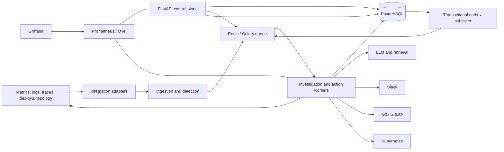

# OpsMind Architecture

**Status:** Proposed architecture  
**Audience:** contributors, operators, and reviewers  
**Scope:** Production-grade incident detection, investigation, communication, and controlled remediation. This document describes the design only; it does not specify implementation code.

## 1. Goals and design principles

OpsMind is an incident-response control plane for distributed applications. It consumes operational signals, detects or accepts incidents, gathers evidence across observability and change systems, maintains a durable incident record, and helps responders reach and execute a safe resolution.

The design follows these principles:

- **Humans retain control.** The system may investigate and recommend actions. Destructive or production-changing actions require an explicit, scoped approval, except for actions explicitly enrolled in a separately governed safe-action policy.
- **PostgreSQL is the system of record.** Queue messages, caches, vector indexes, and integration state are rebuildable or reconcilable; they do not replace durable incident and audit records.
- **At-least-once delivery, idempotent effects.** Workers and integrations assume duplicate messages, retries, and reordering. Exactly-once execution is not claimed.
- **Evidence before conclusions.** Root-cause hypotheses link to timestamped source evidence, state confidence and alternatives, and distinguish observation from inference.
- **Provider and vendor boundaries are replaceable.** Observability, LLM, chat, source-control, and cluster integrations implement ports behind application services.
- **Degrade safely.** An unavailable model or integration reduces investigation depth; it must not bypass approval, audit, or access controls.
- **Tenant and environment boundaries are explicit.** Every resource and action is scoped to an organization, environment, and authorized principal.

Non-goals for the initial release: replacing a full observability platform, autonomously changing arbitrary production infrastructure, guaranteeing a diagnosis, or acting as the authoritative deployment system.

## 2. High-level architecture

Deploy as a modular monolith initially: one Python codebase with separately scalable API, scheduler/dispatcher, and worker processes. Keep domain and application boundaries independent of process layout. Split a service only when scaling, availability, or team ownership justifies the operational cost.

### Runtime topology

- **API/control plane:** FastAPI; authentication, authorization, validation, incident queries and commands, approval endpoints, integration configuration, and operator-facing status.
- **Scheduler and signal ingestion:** periodic polling, webhook receivers, alert ingestion, and reconciliation. Short-lived webhook requests validate and persist/enqueue work; they do not run investigations inline.
- **Celery workers:** bounded, named queues for detection, investigation, notifications, and actions. Redis is the initial broker and may also hold disposable cache/rate-limit data. PostgreSQL stores durable state and the transactional outbox.
- **PostgreSQL:** relational source of truth, audit/event records, configuration, and investigation evidence. Add `pgvector` as an optional retrieval index; keep retrievable incident summaries and metadata in relational tables so the vector index can be rebuilt.
- **External adapters:** metrics/logs/traces providers, Slack, GitLab/Git, and Kubernetes, accessed through typed interfaces and credentials scoped to the minimum required resources.
- **Telemetry:** OpenTelemetry instrumentation exports traces and metrics; Prometheus scrapes application metrics; Grafana dashboards and alerts visualize system and response health.

### Code modules and dependency direction

`domain` owns entities, state machines, policies, and domain events. `application` owns use cases and ports. `adapters` implement database, queue, provider, Slack, Git, and Kubernetes ports. `api` translates HTTP into application commands and queries. `worker` invokes application use cases from queued jobs. Dependencies point inward: domain has no framework or vendor dependencies; adapters do not define business policy. Construct the dependency graph in explicit application composition roots, not in route handlers or domain objects.

## 3. Major components

| Component | Responsibilities | Key safeguards |
|---|---|---|
| Signal adapters | Receive alert webhooks or poll metrics/logs/traces; normalize timestamps, labels, service identity, and source links | Validate signatures, bound payload sizes, redact secrets, rate-limit, preserve source provenance |
| Detection engine | Evaluate configured rules/windows and deduplicate alert fingerprints into incidents | Deterministic rules first; explicit thresholds, cooldowns, and environment scoping |
| Incident service | Own incident lifecycle, severity, ownership, timeline, deduplication, and transitions | State machine, optimistic concurrency, append-only event/audit history |
| Investigation orchestrator | Plan evidence collection, dispatch bounded tool calls, correlate results, generate and update hypotheses | Per-step deadlines, tool allowlists, budget limits, no direct mutation tools |
| Evidence/correlation service | Query metrics, logs, traces, deployments, dependencies, and similar historical cases over incident time windows | Time bounds, query limits, provenance, tenant filters, PII/secret scrubbing |
| LLM gateway | Provider abstraction, structured output validation, prompt/version tracking, token/cost limits | Treat model output as untrusted; validate schema and claims; no implicit authority |
| Retrieval service | Find relevant resolved incidents and runbooks from metadata and optional vector similarity | Tenant/environment ACL filtering before ranking; versioned embeddings; citation required |
| Notification service | Post incident opened/updated/resolved messages to Slack and process authorized Slack interactions | Idempotency keys, signed requests, channel allowlists, no approval from unauthenticated text |
| Action/approval service | Represent proposed actions, risk, prerequisites, approval, execution, and result | Separate propose/approve/execute permissions; approval binds exact action digest and target |
| Kubernetes/Git action adapters | Perform narrowly defined operations such as rollout undo or approved Git revert | Explicit allowlists, dry-run/preflight, scoped credentials, timeout, postcondition verification |
| Audit and outbox | Persist audit records and publish domain events reliably | Same-transaction writes; append-only audit policy; outbox retry and dedupe |
| Operator API/UI | Query incidents, evidence, hypotheses, approvals, and audit timeline | Pagination, role checks, conditional updates, no secrets in responses |

## 4. Data flow

### Detection and incident creation

1. An alert webhook or scheduled detector receives a signal. The adapter verifies its source, normalizes it, assigns tenant/environment/service identifiers, and records the source reference.
2. Detection rules evaluate the signal or a bounded metric window. A stable fingerprint (tenant, environment, rule, affected entity, and normalized dimensions) deduplicates repeats and supports flapping/cooldown policies.
3. In one database transaction, OpsMind creates or updates the incident, appends a timeline/audit event, and inserts an outbox record. The request is acknowledged after durable acceptance, not after full investigation.
4. The outbox publisher delivers an `IncidentCreated` or `IncidentUpdated` message to the queue. A repeated delivery is harmless because consumers use event IDs and idempotency keys.

### Investigation and hypothesis

1. The orchestrator creates an investigation run with an immutable snapshot of the incident context and a bounded time range.
2. Parallel read-only collectors retrieve metrics, logs, traces, deployment changes, dependency topology, runbooks, and similar historical incidents. Each finding records query parameters, source, event time, collection time, and a durable reference or redacted excerpt.
3. Correlation normalizes service/resource identities and aligns evidence against the incident window and baseline. Missing data is recorded as unavailable, not treated as evidence of absence.
4. Retrieval applies authorization filters before ranking. The LLM gateway receives only the minimum redacted evidence needed and returns schema-constrained hypotheses with evidence IDs, confidence, alternatives, and recommended next checks.
5. The application validates all evidence references against the run, persists the result, and records provider/model/prompt versions and usage. Invalid or unsupported output is rejected or stored as an investigation error, never silently trusted.
6. A summary and selected evidence links are sent to Slack through the notification queue. New signals can start another investigation revision without erasing prior results.

### Approval and execution

1. A remediation proposal records an action type, exact target and parameters, expected effect, risk, preconditions, expiry, rollback/compensation plan, and evidence/hypothesis references.
2. A user with `action:approve` reviews the immutable action digest. Approval is scoped to that digest, target, environment, and expiry; edits invalidate approval. Two-person approval may be required by policy for high-risk actions.
3. For ordinary actions, an authorized user explicitly requests execution. The action service rechecks approval, policy, preconditions, target state, and idempotency key immediately before invoking the adapter.
4. A pre-approved safe action may execute automatically only if it matches a versioned, tenant/environment-scoped policy including exact action class, target constraints, rate limits, health gates, and rollback/stop conditions. Enrollment and policy changes require privileged review and are audited.
5. Execution status and observed postconditions are persisted. Failure, timeout, or uncertain completion stops retries that could duplicate a dangerous effect and triggers reconciliation or human escalation. A configured safe rollback may be attempted only within its policy and is itself audited.

## 5. Database entities

Use UUID primary keys, UTC timestamps, tenant keys on tenant-owned rows, foreign keys, bounded JSONB only for provider-specific or evolving payloads, and explicit schema migrations. Store secrets outside the database or as envelope-encrypted references to a secrets manager. Apply row-level security as defense in depth where operationally supportable.

| Entity | Important fields and relationships |
|---|---|
| `Organization` / `Tenant` | ID, name, status, settings, retention policy |
| `User` / `Membership` | Principal ID, tenant ID, role bindings, identity-provider subject, status |
| `Environment` | Tenant, name, cluster/account identifiers, data classification, policy references |
| `Service` | Tenant/environment, stable service key, ownership, repository, labels |
| `ServiceDependency` | Source and target service, relationship, validity interval, source/provenance |
| `Integration` | Tenant/environment, provider, configuration, credential reference, health state, sync cursor; secrets excluded |
| `DetectionRule` | Scope, query/condition, thresholds, window, severity, enabled state, version |
| `Signal` | Source, fingerprint, observed time, service/environment, normalized dimensions, redacted payload/reference |
| `Incident` | Tenant, environment, dedupe fingerprint, title, severity, status, opened/updated/resolved times, owner, version |
| `IncidentEvent` | Incident, type, actor, timestamp, idempotency key, structured payload; append-only timeline |
| `InvestigationRun` | Incident, revision, status, time window, trigger, model/prompt versions, usage, started/completed times |
| `Evidence` | Run/incident, kind, source, observed/collected times, query metadata, redacted content/reference, integrity hash |
| `Hypothesis` | Run, summary, confidence, status, supporting and contradicting evidence IDs, alternatives, next checks |
| `HistoricalIncidentDocument` | Resolved incident/runbook summary, tenant scope, tags, embedding version/vector reference, ACL and freshness metadata |
| `ActionProposal` | Incident/run, action type, target, parameters, risk, preconditions, digest, expiry, state, compensation plan |
| `Approval` | Proposal digest, approver, decision, scope, timestamp, expiry, authentication context |
| `ActionExecution` | Proposal/approval, idempotency key, executor, state, attempt, start/end, result, postcondition, external operation ID |
| `AuditRecord` | Tenant, actor/service identity, operation, object, outcome, request/correlation ID, timestamp, redacted before/after summary, integrity linkage |
| `OutboxEvent` | Event ID/type/version, aggregate ID/version, payload, created/published times, retry state |
| `WebhookDelivery` | Provider, external delivery ID, received/validated state, body hash, response, dedupe key |

Indexes should support tenant-scoped incident lists by status/severity/time, fingerprint lookup, timeline ordering, outbox polling, action idempotency, and evidence lookup by incident/run/time. Partition high-volume signal/audit tables by time only after measuring workload and retention needs. Define retention and deletion behavior explicitly; regulatory deletion must preserve required audit integrity while honoring applicable policy.

## 6. API boundaries

The initial Incident Management API is exposed at the root paths below; it does not yet use the proposed `/api/v1` prefix. Add a versioned prefix before publishing a stable external API contract. Authenticate humans through OIDC/OAuth2 and service integrations through signed webhooks or scoped service credentials. Use typed Pydantic request/response models, consistent error envelopes, pagination cursors, request IDs, and idempotency keys for mutating operations.

| Boundary | Representative routes / contract |
|---|---|
| Incidents | `GET /incidents`, `POST /incidents` (manual), `GET /incidents/{id}`, `PATCH /incidents/{id}` (allowed metadata/state transitions), `GET /incidents/{id}/timeline` |
| Investigation | `POST /incidents/{id}/investigations`, `GET /investigations/{id}`, `GET /incidents/{id}/evidence`, `GET /incidents/{id}/hypotheses` |
| Actions | `POST /incidents/{id}/actions` (propose), `POST /actions/{id}/approvals`, `POST /actions/{id}/execute`, `GET /actions/{id}` |
| Integrations | `GET/POST /integrations`, `POST /integrations/{id}/test`, `POST /webhooks/{provider}` |
| Configuration | `GET/POST /detection-rules`, `GET/POST /services`, `GET/POST /environments`; mutations require administrative roles and audit events |
| Operational status | `GET /health/live`, `GET /health/ready`, `GET /health/dependencies`; readiness reports required dependencies without exposing credentials |

Long-running tasks return `202 Accepted` with a resource URL and operation ID. Webhooks validate signature, timestamp/replay window, content type, and payload size before recording delivery. Do not expose internal Celery task names or allow callers to submit arbitrary SQL, PromQL, LogQL, shell commands, Kubernetes manifests, or model tools. Keep public APIs separate from worker-only application interfaces.

## 7. Event types and delivery semantics

Events are versioned envelopes with `event_id`, `event_type`, `timestamp`, `correlation_id`, `causation_id`, `source`, `payload`, and `schema_version`. `tenant_id` and aggregate metadata are optional extensions. Events contain references and sanitized metadata, not credentials or unnecessary raw telemetry.

The implemented initial event catalog is `MetricAnomalyDetected`, `LogAnomalyDetected`, `IncidentCreated`, `IncidentUpdated`, `InvestigationStarted`, `EvidenceCollected`, `HypothesisGenerated`, `RemediationProposed`, `RemediationApproved`, `RemediationStarted`, `RemediationCompleted`, `RemediationFailed`, and `IncidentResolved`. Additional signal, notification, integration, and administration events remain part of the broader target design.

Persist domain state, audit/timeline record, and outbox row in a single transaction. Publish outbox records asynchronously; mark delivery only after broker acknowledgment. Consumers keep an inbox/deduplication record or use unique constraints on event/idempotency IDs and commit their state change with the dedupe marker. Events are notifications to perform work; consumers reload authoritative state and validate current state before acting. Use exponential backoff with jitter, bounded attempts, dead-letter queues, alerting, and operator replay tooling. Ordering is guaranteed only per aggregate where explicitly implemented through aggregate versions; consumers reject stale transitions.

## 8. Failure modes and recovery

| Failure | Behavior and recovery |
|---|---|
| Duplicate, delayed, or out-of-order signal | Fingerprint and delivery dedupe; use source/event time; apply aggregate version checks; retain late data for investigation refresh |
| PostgreSQL unavailable | Fail readiness and reject new durable work; do not acknowledge webhook/request as accepted before commit; workers retry boundedly |
| Redis/broker unavailable | Outbox remains durable; pause publication, alert, and resume on recovery; API can accept only work it can persist transactionally |
| Worker crash or poison message | Lease/visibility timeout and retry; idempotent consumer; dead-letter after bounded attempts; expose replay with audit |
| Telemetry provider timeout/rate limit | Per-provider concurrency limits, circuit breaker, deadline, backoff; partial investigation marked with missing sources |
| Incomplete or contradictory evidence | Present gaps and conflicts; lower confidence; keep hypotheses versioned and link evidence; request targeted follow-up |
| LLM timeout, outage, malformed output, or hallucination | Retry only within budget; schema and citation validation; fallback deterministic summary or `investigation_pending`; no action authority |
| Slack outage or revoked token | Persist notification intent, retry/backoff, surface delivery status and API link; do not block incident state changes |
| Kubernetes/Git API timeout after request | Mark execution `unknown`/reconciling; query external operation and observed state before retry; escalate if effect cannot be determined |
| Stale or revoked approval | Revalidate digest, expiry, approver status, target, policy, and preconditions at execution time; reject safely |
| Unsafe or partial remediation | Stop action chain; execute only a pre-authorized compensation policy; verify health and escalate; record all attempts and effects |
| Credential compromise | Revoke/rotate integration credential, disable integration, audit scope, investigate access, and minimize blast radius through narrow credentials |
| Clock skew or telemetry lag | Preserve source and ingestion timestamps separately; use bounded watermark/grace periods and annotate uncertainty |
| Storage growth / retention pressure | Apply configured TTL/archival to raw evidence and signals; preserve incident summaries/audit per policy; alert before capacity exhaustion |

Backups must be encrypted and restoration tested. Document RPO/RTO targets and operational runbooks before production; these are deployment-specific and should not be presented as guarantees until validated.

## 9. Security model

- **Identity and authorization:** OIDC for users; workload identity or short-lived service credentials for services. RBAC roles include viewer, responder, approver, action executor, integration administrator, and tenant administrator. Add environment-level scopes and separation of duties. Every query and mutation enforces tenant and environment scope.
- **Approval controls:** Proposing, approving, and executing are distinct permissions. Approval is bound to an immutable digest, precise target, environment, expiry, and policy version. Enforce reauthentication/MFA where available and two-person approval for configured risk classes. Slack messages alone do not authorize actions.
- **Safe automation:** Explicit allowlisted action types and target constraints; policy-as-data with reviewed versions; preflight, rate/concurrency limits, health checks, kill switch, and compensation rules. Default is disabled. Policy enrollment and modifications are privileged, reviewed, and audited.
- **Secrets:** No hard-coded secrets. Load local values from ignored environment files or a local secret store; production uses a cloud/Kubernetes external secret manager. Persist only secret references; encrypt in transit and at rest; rotate and audit access. Avoid logging auth headers, tokens, raw prompts containing sensitive data, and unredacted telemetry.
- **Integration hardening:** Verify Slack/provider signatures and replay windows; restrict webhook egress; allowlist Slack workspaces/channels and Kubernetes clusters/namespaces/resources. Kubernetes service accounts get only required verbs/resources. Git tokens are repository-scoped and read-only unless a narrowly defined action requires write access.
- **LLM/data controls:** Send only minimized, redacted context to configured providers. Make provider region, retention, and training settings explicit. Defend against prompt injection in logs, tickets, and runbooks: retrieved content is untrusted data, cannot change system policy, and cannot grant tools or authority. Tool calls are read-only in investigation; mutation goes through action service controls.
- **Application and supply chain:** Validate input and output schemas, use parameterized database access, enforce SSRF protections on configured endpoints, apply request/body limits, dependency scanning, signed/reproducible container images, non-root containers, read-only filesystems where possible, and network policies.
- **Audit:** Record actor, authorization decision, action digest, policy version, approvals, external operation IDs, outcome, and correlation IDs. Audit records are append-only at the application layer and protected against unauthorized modification; export to a separately controlled immutable sink for high-assurance deployments.
- **Privacy and retention:** Classify and redact personal or customer data, minimize stored raw logs, set tenant-configurable retention, support deletion workflows where applicable, and document the audit-retention exception model.

Threat model includes cross-tenant access, spoofed/replayed webhooks, compromised Slack/Git/Kubernetes credentials, prompt injection, malicious telemetry content, confused-deputy behavior, approval spoofing, duplicate execution, and denial of service through high-cardinality or oversized signals.

## 10. Observability strategy

Instrument API, scheduler, adapters, and workers with OpenTelemetry traces and structured JSON logs. Propagate trace/correlation IDs across HTTP, queue messages, DB operations, provider calls, and Slack notification attempts. Logs must carry tenant/incident IDs only where permitted and must exclude secrets and unredacted payloads. Use exemplars or trace links from latency/error metrics where supported.

### Service health metrics

- API request count, latency histogram, error count, auth denials, and rate-limit decisions by route/status (avoid unbounded labels).
- Queue depth/oldest-message age, task latency, retries, dead-letter count, worker concurrency, outbox lag, and scheduled job drift.
- PostgreSQL connection saturation, transaction latency, pool wait, migration status; Redis availability, latency, and memory pressure.
- Integration call count/latency/error/rate-limit/circuit state by provider and operation.
- LLM request latency/error, token usage, estimated cost, schema rejection rate, and budget exhaustion by provider/model class (no prompt/user labels).
- Evidence source coverage and freshness, failed collectors, and investigation completion/partial-result rate.

### Incident-response effectiveness metrics

- Detection-to-incident latency; incident acknowledgement and assignment latency.
- Time to first useful evidence, first hypothesis, human-confirmed root cause, and resolution; report distributions and segment by severity/environment.
- Investigation completion rate, evidence-source coverage, hypothesis acceptance/correction rate, and reopened/recurring incident rate.
- Slack notification delivery latency/failure rate and update cadence.
- Proposed-to-approved/denied action rate, approval latency, execution success/failure/unknown rate, rollback/compensation rate, and post-action health-check result.
- Human override and safe-automation invocation counts, with policy/action-class labels from bounded allowlists.

Define metric semantics and denominator rules before using them for service-level objectives. Avoid optimizing for low MTTR alone; pair response speed with recurrence, rollback, and customer-impact measures. Grafana dashboards should cover service health, queue/outbox, integration health, incident funnel, investigation quality, and action safety. Prometheus alerts should cover user-visible failure, growing queue/outbox lag, dead-letter growth, database saturation, integration degradation, and any action stuck in an uncertain state. Alert on actionable conditions and route operational alerts independently of the Slack integration being monitored.

## 11. Local and production deployment

### Local development

Docker Compose runs the API, worker, scheduler, PostgreSQL, Redis, and optional local observability stack (Prometheus/Grafana/OTel Collector). Provide seeded synthetic services/incidents and deterministic fake provider adapters so contributors can exercise flows without production credentials. Configuration comes from validated environment variables; document safe local defaults and `.env.example` with placeholders only.

### Kubernetes production

Package API, scheduler, and worker roles as separate Deployments from the same versioned image. Use readiness/liveness probes, resource requests/limits, pod disruption budgets where appropriate, graceful worker shutdown, autoscaling based on queue age/depth and CPU, network policies, non-root security context, and rolling/rollback strategy. Provision PostgreSQL and Redis as managed or explicitly operated stateful services with backups, HA, encryption, and monitoring. Terraform provisions cloud infrastructure and identity/secrets integration; Kubernetes manifests/Helm/Kustomize configure workloads. Prometheus/Grafana/OpenTelemetry integrate with the platform's existing telemetry stack where possible. No environment should depend on an in-cluster Redis broker as the only durable queue state.

## 12. Testing strategy

Build confidence in layers (tests are part of the planned project, not included in this architecture artifact):

- Unit tests for state transitions, dedupe, authorization, action policies, schema validation, correlation rules, and retry decisions using fakes.
- Contract tests for provider adapters, event schemas, webhook signatures, LLM structured-output parsing, and database migrations.
- Integration tests against PostgreSQL and Redis using disposable containers; validate transaction/outbox behavior and duplicate delivery.
- End-to-end tests for signal-to-incident-to-investigation-to-Slack, approval-to-action, and safe-action rollback using local fake integrations and a test Kubernetes target.
- Security tests for tenant isolation, authorization matrices, replay protection, prompt injection resilience, secret redaction, SSRF, and idempotent execution.
- Load/failure tests for bursts, queue backlog, provider timeouts, worker termination, database failover, and uncertain action completion.

## 13. Phased implementation plan

1. **Foundation and contracts:** repository layout, domain glossary/state machines, Pydantic settings, structured logging, API skeleton, migrations, Compose, CI, typing/lint policy, auth/RBAC model, and audit/outbox primitives.
2. **Incident lifecycle:** manual/API incident creation, signed alert ingestion, deterministic rules, dedupe, severity/ownership, timeline, event delivery, and responder API. Include unit and PostgreSQL/Redis integration coverage.
3. **Read-only observability correlation:** provider ports and first adapters, bounded evidence collection for metrics/logs/traces/deploys/dependencies, evidence provenance, partial-failure handling, and incident detail views.
4. **AI-assisted investigation:** LLM gateway with provider abstraction, typed structured outputs, prompt/version and cost tracking, citation validation, historical incident retrieval, and read-only investigation tools. Start behind feature flags and compare with deterministic baselines.
5. **Slack communications:** incident channel/message workflow, idempotent updates, signed interaction handling, delivery reconciliation, and role-checked links back to OpsMind.
6. **Human-approved remediation:** action catalog and dry-run/preflight, immutable proposals, scoped approval, executor authorization, initial Kubernetes/Git actions, postcondition checks, uncertain-state reconciliation, and immutable audit export.
7. **Guarded safe automation:** introduce only low-risk, reversible actions with explicit policy enrollment, health gates, rate limits, kill switch, compensation, staged rollout, and measured review. Keep disabled by default until operational evidence supports enablement.
8. **Production hardening and portfolio release:** Kubernetes/Terraform deployment, secrets manager, SLOs and dashboards, backup/restore drills, load/failure/security testing, runbooks, threat model, sample architecture and demo data, contributor docs, and release process.

Each phase should ship a usable vertical slice with migrations, operational documentation, metrics, and rollback strategy. Promote capabilities through local/dev/staging before production; gate risky behavior with per-tenant feature flags and explicit policy.

## 14. Key decisions to validate during implementation

- Initial supported telemetry providers and whether ingestion is push, pull, or both.
- Celery/Redis operational limits versus a durable broker if workload or delivery guarantees outgrow the initial deployment.
- Authentication provider, tenant model, and whether single-tenant installations need a simplified mode.
- LLM provider/data-retention constraints, model routing, and cost ceilings.
- Required audit retention, immutable export destination, and tenant deletion obligations.
- Safe-action catalog and the evidence required before any action can be considered pre-approved.
- Deployment-specific availability, RPO/RTO, and SLO targets.
