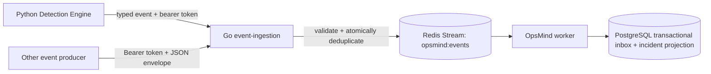

# Go event ingestion

OpsMind now includes a Go HTTP service for authenticated event ingestion.
The Detection Engine sends its typed anomaly and correlated-incident events
through this service; other trusted producers can use the same endpoint. The
Python worker and existing Redis Streams consumers remain unchanged.

## Contract and flow

`packages/models/contracts/event-envelope-v1.schema.json` is the shared
language-neutral envelope contract. The Python Pydantic model remains the
domain type. The checked-in fixture is parsed by both the Go service tests and
the Python contract test so either side can catch accidental incompatibility.



The Go service validates the envelope, generates the contract defaults for an
omitted `event_id`, `timestamp`, or `schema_version`, and uses a Redis Lua
script to atomically append the event and record the event ID. Replays within
the configured deduplication TTL return the original stream entry ID without
adding another entry. The default TTL is 24 hours. After expiry, the same ID
can be published again, so clients should retain their event ID across
retries. Redis failures return HTTP 503 so producers can retry safely. Unknown
envelope-level fields are ignored to match Pydantic's forward-compatible
default behavior; unknown fields inside `payload` are retained.

The service does not connect to PostgreSQL, query monitoring systems, execute
commands, or make incident decisions. Redis remains the durable event
boundary; the existing Python worker remains responsible for its transactional
PostgreSQL inbox and incident projection. The Detection Engine still uses
Redis directly for short-lived signal deduplication keys, while event payloads
go through Go.

## Local use

Set a high-entropy local token. Compose falls back to the local demo token if
`OPSMIND_EVENT_INGESTION_TOKEN` is empty:

```bash
openssl rand -hex 32
# Put the value in OPSMIND_LOCAL_DEMO_TOKEN (or OPSMIND_EVENT_INGESTION_TOKEN) in .env
set -a; source .env; set +a
export OPSMIND_EVENT_INGESTION_TOKEN="${OPSMIND_EVENT_INGESTION_TOKEN:-$OPSMIND_LOCAL_DEMO_TOKEN}"
docker compose up --build -d event-ingestion detection-engine worker
```

The service is exposed on loopback at `http://localhost:8006`. Submit an
envelope using the same token value:

```bash
curl --fail-with-body -i http://localhost:8006/v1/events \
  -H "Authorization: Bearer $OPSMIND_EVENT_INGESTION_TOKEN" \
  -H 'Content-Type: application/json' \
  -H 'X-Correlation-ID: sample-run-01' \
  --data '{
    "event_id":"5f7622a1-5d2f-4b6f-b981-64ea003d195a",
    "event_type":"MetricAnomalyDetected",
    "timestamp":"2026-10-16T10:30:00Z",
    "correlation_id":"sample-run-01",
    "source":"manual-demo",
    "schema_version":1,
    "payload":{"service":"payment-service","score":91}
  }'
```

The first call returns `202 Accepted`; a replay with the same `event_id`
returns `200 OK` with `published: false`. The endpoint requires a bearer token
of at least 24 characters and accepts JSON request bodies up to 1 MiB. The
token is compared in constant time and request/event payloads are not written
to logs.

Health and metrics endpoints:

| Endpoint | Purpose |
|---|---|
| `GET /health/live` | Process liveness |
| `GET /health/ready` | Readiness, including Redis connectivity |
| `GET /metrics` | Request, publish, duplicate, invalid-envelope, failure, and unauthorized counters |
| `POST /v1/events` | Authenticated event ingress |

## Configuration

| Variable | Default | Meaning |
|---|---|---|
| `OPSMIND_REDIS_URL` | `redis://redis:6379/0` | Redis connection URL |
| `OPSMIND_EVENT_STREAM` | `opsmind:events` | Redis stream consumed by OpsMind |
| `OPSMIND_EVENT_INGESTION_TOKEN` | required | High-entropy bearer credential, at least 24 characters |
| `OPSMIND_EVENT_INGESTION_DEDUPE_TTL` | `24h` | Redis event-ID deduplication window; minimum `1m` |
| `OPSMIND_EVENT_INGESTION_LISTEN_ADDRESS` | `:8000` | HTTP listen address |

In Kubernetes the workload has no service-account token, runs as non-root,
uses a read-only root filesystem, has bounded resources, and reaches Redis
through the existing namespace network policy. Put the token in the
`opsmind-runtime` Secret; never put a populated credential in a ConfigMap or
repository file. GitLab builds, scans, generates an SBOM for, signs, and deploys
the immutable event-ingestion image alongside the other OpsMind images.

## Development checks

Use Go 1.24 or newer to run the local tests and vet checks; Docker builds the
Go service in its own multi-stage image.

```bash
make go-check
```

The Go unit tests use an in-memory publisher for HTTP behavior and the shared
contract fixture. End-to-end Redis delivery is exercised by the Compose
service.
